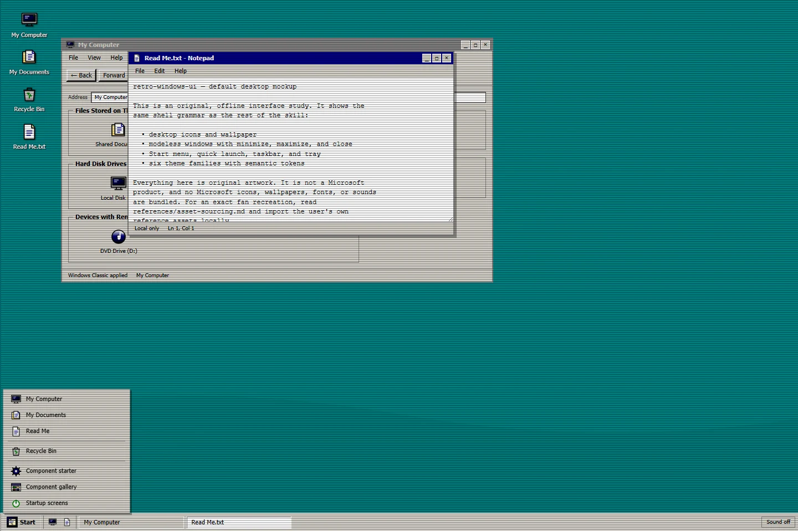
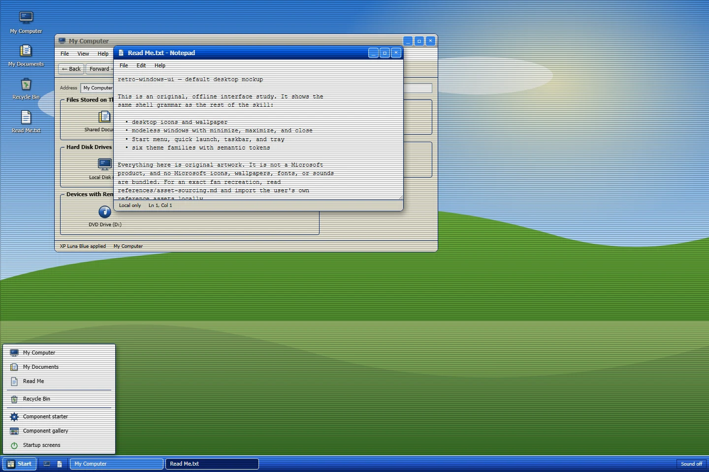
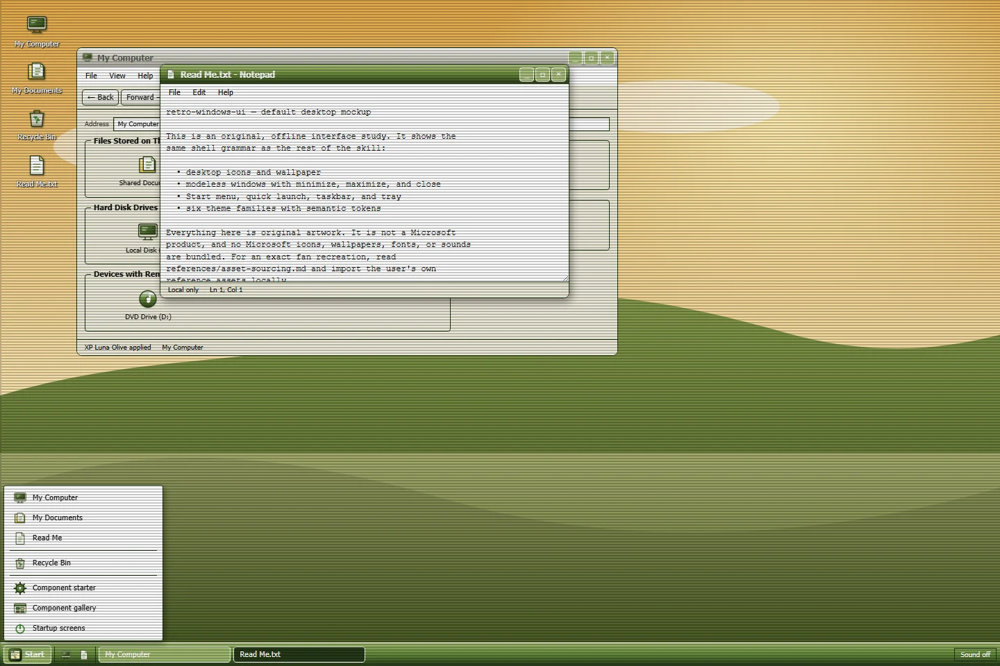
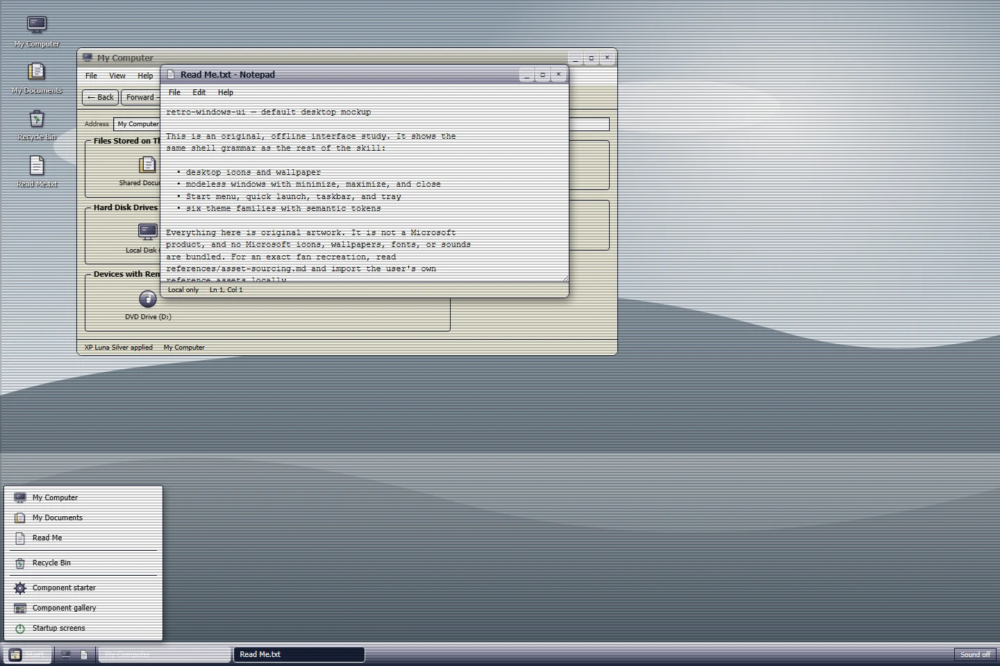
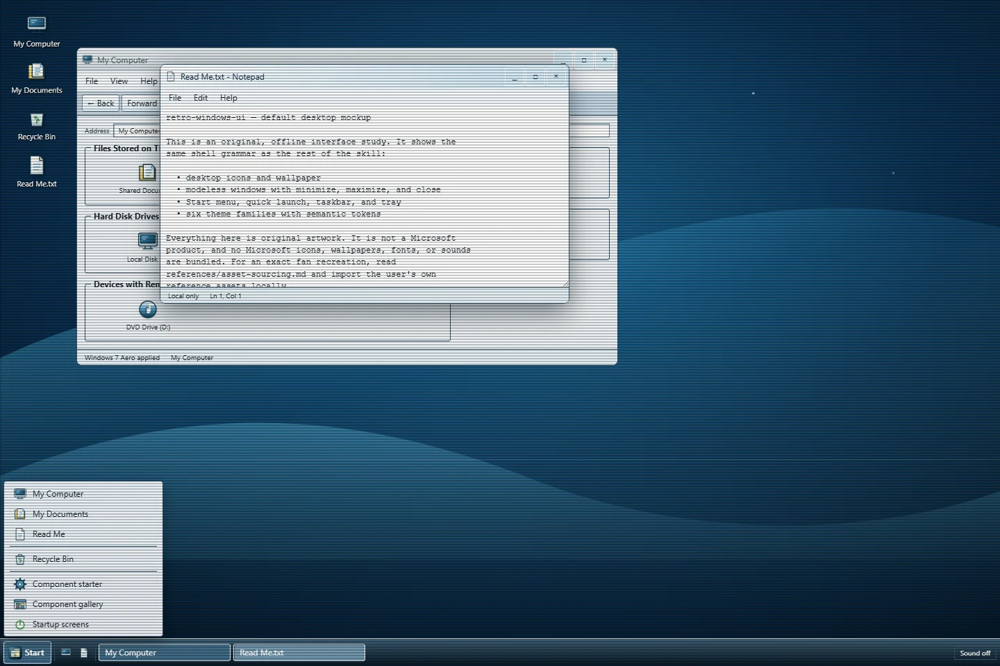
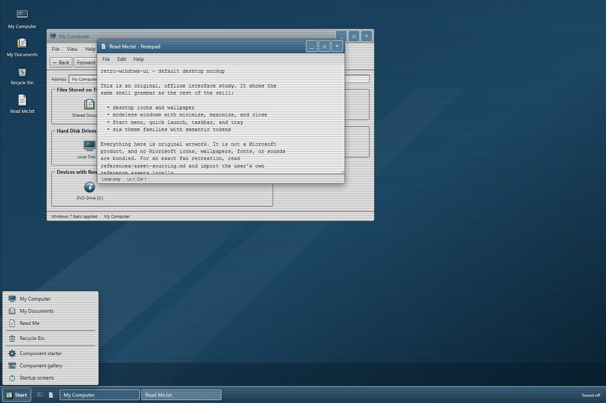
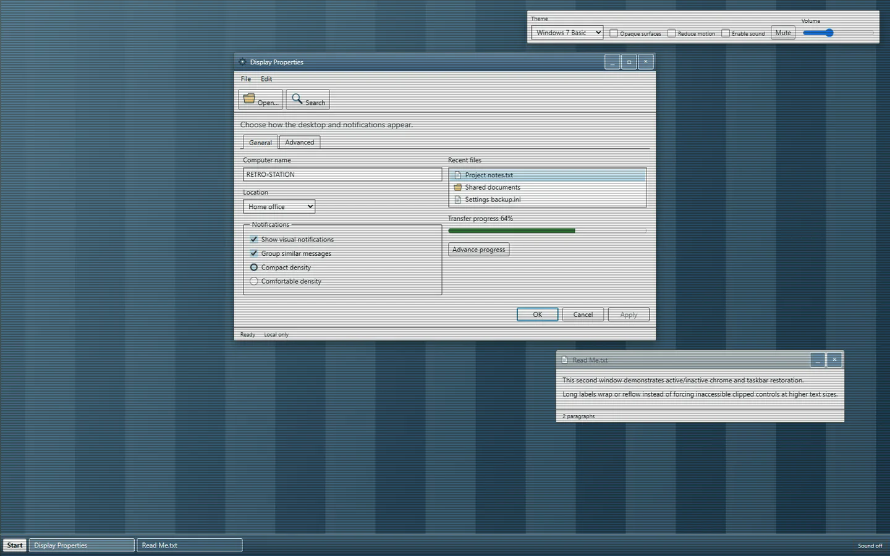

# retro-windows-ui


A portable Agent Skill for designing, building, retrofitting, and reviewing retro Windows interfaces. It combines era-specific design guidance with complete original offline asset families, semantic tokens, a default Windows desktop mockup, startup-screen examples, an interactive gallery, and opt-in UI sound effects.

Every interface image in this README is the bundled offline mockup or starter. No separate portfolio build is included or required. README stills carry a presentation-only scanline overlay; the bundled interfaces remain clean unless a CRT effect is explicitly requested.

## Themes

- **Windows Classic** — Windows 95/98/2000 visual grammar, hard bevels, dense desktop controls.
- **XP Luna** — blue, olive, and silver variants with shared Luna geometry.
- **Windows 7** — Aero glass and an opaque Basic treatment.

Each theme is a complete kit, not a color swap:

- 30 original shell icons: computer, documents, folders, recycle bin, network, internet, email, search, settings, control panel, help, run, programs, briefcase, pictures, music, volume, mute, power, log off, user, task manager, AI, code, design, info, and warnings.
- An original 1600×1000 wallpaper, texture, start mark, brand mark, and every window caption glyph.
- Six startup-screen examples: Classic, XP loading and Welcome, and Windows 7; all are skippable and reduced-motion safe.
- A complete [default Windows desktop mockup](skills/retro-windows-ui/assets/desktop/index.html) with desktop icons, My Computer, My Documents, Read Me, Recycle Bin, Start, quick launch, taskbar, modeless windows, and responsive behavior.

## What the runtime does and does not include

The public runtime **does not** bundle Microsoft fonts, logos, extracted shell icons, wallpapers, boot screens, or system sounds. Microsoft-owned media cannot be redistributed in this public CC0 package. That is a rights constraint, not a lower-fidelity design choice: every era still ships the complete geometry, icon family, wallpaper, startup sequence, and behavior needed to build the interface.

The runtime also ships no portfolio template. Its full-shell example is the neutral [default Windows desktop mockup](skills/retro-windows-ui/assets/desktop/index.html); portfolio information architecture is covered as guidance in [references/portfolio-patterns.md](skills/retro-windows-ui/references/portfolio-patterns.md).

For an exact fan recreation, [references/asset-sourcing.md](skills/retro-windows-ui/references/asset-sourcing.md) documents how to import authentic assets from a user-supplied local reference, keep them out of the public package, and record the source and rights. The installable skill remains original and shippable.

## The default desktop mockup

The bundled [desktop mockup](skills/retro-windows-ui/assets/desktop/index.html) is the complete shell example. It is not a portfolio template: it includes desktop icons, My Computer, My Documents, Read Me in Notepad, Recycle Bin, Start, quick launch, taskbar, modeless windows, and responsive behavior, with all six themes selectable at runtime.

These stills are the mockup itself, captured offline in each theme:

| Windows Classic | XP Luna Blue | XP Luna Olive |
| :---: | :---: | :---: |
| [](docs/media/themes/classic-scanlines.webp) | [](docs/media/themes/xp-luna-blue-scanlines.webp) | [](docs/media/themes/xp-luna-olive-scanlines.webp) |
| **XP Luna Silver** | **Windows 7 Aero** | **Windows 7 Basic** |
| [](docs/media/themes/xp-luna-silver-scanlines.webp) | [](docs/media/themes/win7-aero-scanlines.webp) | [](docs/media/themes/win7-basic-scanlines.webp) |

The skill keeps these eras distinct. Its installable runtime does not bundle Microsoft fonts, logos, extracted icons, wallpapers, or system sounds, and it is not affiliated with or endorsed by Microsoft.

## Repository layout

```text
skills/retro-windows-ui/   Portable runtime skill
  SKILL.md                 Trigger, workflow, and resource routing
  references/              Era, behavior, accessibility, portfolio, and sourcing guidance
  assets/                  Tokens, 269 original assets, starter, desktop mockup, boot, gallery
  scripts/                 Offline catalog, reference importer, and asset validation
evals/                     Agent behavior evaluation scenarios
tests/                     Deterministic repository tests
tools/                     Asset generation, packaging, and browser QA
docs/media/                README screenshots of the bundled mockup and starter
```

## Use the skill

Install the unchanged `skills/retro-windows-ui` directory in the desired agent skills folder:

- Qoder project: `.qoder/skills/retro-windows-ui/`
- Qoder user: `~/.qoder/skills/retro-windows-ui/`
- Claude Code project: `.claude/skills/retro-windows-ui/`
- Claude Code user: `~/.claude/skills/retro-windows-ui/`

In Qoder, run `/skills reload`, verify with `/skills list`, and invoke `/retro-windows-ui` or ask naturally, for example:

> Build an accessible XP Luna file-transfer dialog with progress, cancel, and error states.

The runtime is offline and framework-free. Open `skills/retro-windows-ui/assets/starter/index.html`, `assets/desktop/index.html`, `assets/boot/index.html`, or `assets/gallery/index.html` directly, or serve the assets directory with any static server.



Suggested prompts that exercise the complete kit:

> Build a default XP Luna desktop mockup with My Computer, a Notepad window, desktop icons, Start menu, taskbar, and a theme switcher. Use only original or user-supplied assets.

> Recreate the Windows 7 startup screen using the skill's boot example as the timing reference, then hand off to a skippable desktop with a Start orb and taskbar.

## Catalog and validation

Run from any working directory, substituting the path to the installed skill:

```bash
python skills/retro-windows-ui/scripts/catalog.py themes
python skills/retro-windows-ui/scripts/catalog.py show xp-luna-blue --json
python skills/retro-windows-ui/scripts/catalog.py assets --kind audio
python skills/retro-windows-ui/scripts/validate_assets.py
```

Scripts resolve their own resources relative to `SKILL.md`; they do not depend on the caller's working directory or network access.

## Build and package

Python 3.10 or later is sufficient for generation, validation, tests, and packaging:

```bash
python tools/build_assets.py
python tools/build_assets.py --check
python -m unittest discover -s tests -v
python tools/package_skill.py
```

The release is written to `dist/retro-windows-ui.skill`. It is a deterministic ZIP archive with one top-level `retro-windows-ui/` directory and no development tests, evals, caches, or installation copies.

## Browser QA

Create a development environment and install the pinned browser dependency:

```bash
python -m venv .venv
.venv/Scripts/python -m pip install -r requirements-dev.txt
.venv/Scripts/python -m playwright install chromium
.venv/Scripts/python tools/browser_qa.py
```

On POSIX shells, use `.venv/bin/python`. Screenshots and results are written to the ignored `artifacts/` directory. Browser QA checks all themes, keyboard interactions, reduced modes, local resources, and opt-in audio behavior.

## Asset and sound policy

All bundled visual and audio assets are original and covered by `assets/LICENSE.txt`. `assets/manifest.json` records provenance, licensing, dimensions or audio metadata, byte size, and SHA-256. Unknown-provenance material is not shippable.

The complete shell set is generated deterministically by `tools/build_assets.py`: 30 icons per theme, nine wallpapers including Classic 95/98/2000 alternates, six start/brand marks, six decoration sets, semantic tokens, and four synthesized cues. No Microsoft binary is bundled.

For a user-supplied authentic reference, copy artwork into a project without touching the public runtime and record its provenance:

```bash
python skills/retro-windows-ui/scripts/import_reference_assets.py \
  --source /path/to/local/reference \
  --target /path/to/project/assets/reference \
  --label "win32.run reference, accessed 2026-10-29"
```

The importer never downloads anything, skips font files, refuses symlinks, and refuses to write inside the installed skill runtime. It writes an `IMPORTED-CREDITS.txt` with SHA-256 hashes and a rights warning; see [asset-sourcing.md](skills/retro-windows-ui/references/asset-sourcing.md).

Sound is muted until explicit user opt-in. Every cue has visible feedback, and mute/volume controls persist when storage is available. CRT, boot, and similar nostalgia effects are not part of the authentic default interface.

## License

Repository code and documentation are MIT licensed. Original bundled assets are CC0-1.0; see `skills/retro-windows-ui/assets/LICENSE.txt`. Historical source documents remain linked references under their respective terms.
